# Лабораторная работа №2

**Студент:** Михлин Дмитрий  
**Вариант:** 6  

## Задание 1.4 — Время

### Что делает
Хранит секунды с начала суток, выводит время в формате `ЧЧ:ММ:СС`.

### Алгоритм
1. Запоминаем секунды.
2. Убираем лишние сутки
3. Считаем часы, минуты, секунды.
4. Склеиваем строку.

### Результат

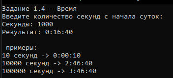
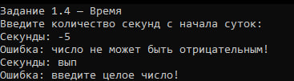

---

## Задание 1.5 — Дом

### Что делает
Хранит этажи, выводит `"дом с N этажами"`.

### Алгоритм
1. Запоминаем этажи.
2. Смотрим на последнюю цифру и две последние.
3. Выбираем окончание: «этаж», «этажа» или «этажей».
4. Склеиваем строку.
### Результат
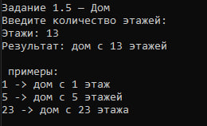
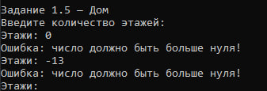

---

## Задание 2.4 — Сотрудники и отделы (как было)

### Что делает
Сотрудник работает в отделе. У отдела есть название и начальник.

### Алгоритм
1. Создаём отдел.
2. Создаём трёх сотрудников.
3. Выбираем начальника.
4. В `ToString()` проверяем: если сотрудник — начальник, выводим одну строку, иначе другую.

### Ввод

### Результат
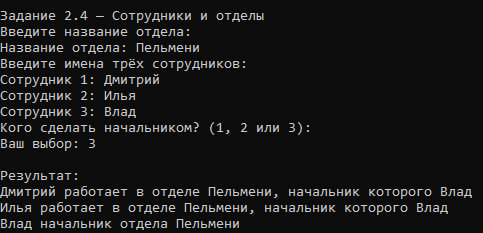
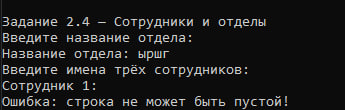

---

## Задание 3.4 — Список сотрудников отдела (переделанное)

### Что делает
Имея ссылку на сотрудника, можно узнать список всех сотрудников его отдела.

### Алгоритм
1. Отдел хранит список всех сотрудников.
2. При создании сотрудника он автоматически добавляется в список отдела.
3. Метод `GetColleagues()` возвращает список всех сотрудников отдела.
4. В `Main`: получаем список через любого сотрудника и выводим.

### Результат
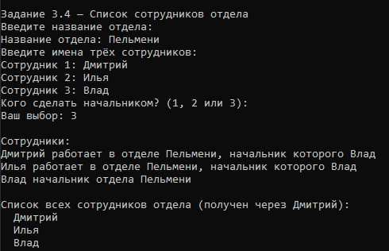
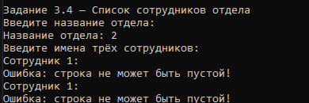

---

## Задание 4.3 — Создаём Дом (неизменяемый)

### Что делает
Дом, у которого нельзя изменить этажи после создания.

### Алгоритм
1. Поле `_floors` — `readonly`.
2. Свойство `Floors` — только `get`.
3. Этажи задаются только в конструкторе.
4. Изменить после создания нельзя.

### Результат

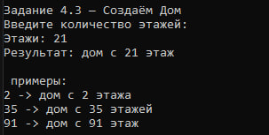
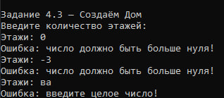

---

## Задание 5.1 — Пистолет

### Что делает
Пистолет с патронами. Стреляет, пока есть патроны.

### Алгоритм
1. По умолчанию — 5 патронов.
2. Метод `Shoot()`:
   - Есть патроны → `"Бах!"` и минус один.
   - Нет → `"Клац!"`.

### Результат
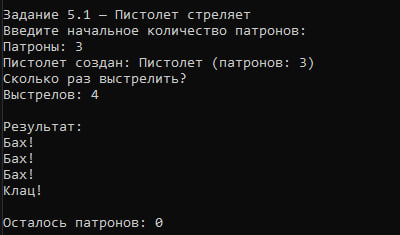
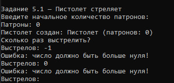
